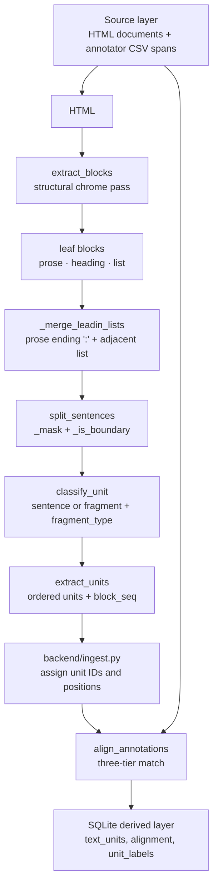

# Extraction logic: deterministic HTML → text units

This document explains the rule-based pipeline in [`backend/extract.py`](../backend/extract.py)
that turns a crawled privacy-policy HTML page into ordered `sentence` and
`fragment` units, then re-aligns the original C3PA annotator spans to those
units. It describes the code at commit `3cd9fcc`; function names are the stable
reference, with the current line number in parentheses.

The pipeline is deliberately small and deterministic: no trained sentencizer,
no model weights, no randomness. Given the same HTML and the same code, it
produces the same units in the same order.

## 1. Why this pipeline exists

### A reproducible alternative to a trained sentencizer

The source C3PA dataset contains crawled HTML and 45,121 expert annotation
spans. The baseline parser used a line-based spaCy sentencizer. This project
replaces that step with explicit rules so that every boundary and every unit
type can be explained, tested, and diffed:

- sentence boundaries come from visible punctuation and a small set of guards,
  not from a learned model;
- a unit is either a **sentence** (a complete thought/idea) or a **fragment**
  with a `fragment_type`;
- the same input always yields the same output, so a corpus snapshot can be
  rebuilt and compared.

Deterministic does not mean perfect. The heuristics have known failure modes;
they are catalogued below so that a change can be judged against them.

### Source layer vs. derived layer

| Layer | Tables | Produced by | Role |
| :--- | :--- | :--- | :--- |
| **Source** | `documents`, `annotations` | The C3PA dataset, read by `backend/ingest.py` | Verbatim HTML, crawl metadata, and annotator rows (`Text`, `Label`, `RANumb`). Never rewritten by this pipeline. |
| **Derived** | `text_units`, `unit_labels`, `alignment` | `backend/extract.py` + `backend/ingest.py` | Re-extracted units, sentence-only label categories, and the annotation→unit mapping. Rebuildable from the source plus the code. |

The derived layer is intentionally separate. A derived label is not a new
human judgment; it is the result of aligning a verbatim source annotation to a
re-extracted unit. That distinction is why the `alignment` table records the
strategy used for every match.

### Provenance and auditability

Every derived row keeps a trail back to source material:

- `documents.html_path`, `documents.crawl_path`, and the source dataset commit
  identify the input page and crawl metadata;
- `annotations.src_row` and `annotations.source_csv` identify the original CSV
  row;
- `text_units.block_seq` and `text_units.block_kind` identify where in the page
  a unit came from (paragraph, heading, or list);
- each `alignment` row records the annotation, the unit, and one of the three
  alignment strategies;
- exports carry their selection, split, and grouping metadata, and the browser
  snapshot is hash-verified against `builds.json`.

The goal is an auditable sentence/label dataset: you can always ask “which
source annotation, in which document, supports this derived unit, and how did
the pipeline connect them?”

### What “sentence” means here

In this codebase, `sentence` is shorthand for **a complete thought or idea**,
not a strict grammatical sentence. Terminal punctuation is a strong proxy but
not a requirement, because:

1. editors often omit a sentence-final period after a URL or email so that the
   resource locator is not altered;
2. contact and opt-out paragraphs sometimes omit final punctuation;
3. one thought is often spread across a bulleted `<li>` list.

The classifier therefore combines length, punctuation, a finite-verb probe,
heading/chrome shapes, and a URL/email-final signal. The deliberate bias is
towards **fragment** when the evidence is weak: a heading typed as a sentence
pollutes the sentence view, while an over-split or over-conservative complete
thought remains visible as typed units (its short or uncertain pieces are
usually fragments). This bias is not a claim that every fragment is
unimportant; see [Known limitations](#6-known-limitations-and-deliberate-bias).

## 2. End-to-end flow



ASCII equivalent:

```text
HTML
  -> extract_blocks            drop chrome, walk DOM, emit leaf blocks
       -> prose | heading | list blocks
  -> _merge_leadin_lists       join "prose ending in ':'" + immediately following list
  -> split_sentences           protect URLs/emails, test punctuation boundaries
       -> ordered sentence candidates
  -> classify_unit             sentence | fragment + fragment_type
  -> extract_units + ingest    order, assign IDs/positions, store text_units
  -> align_annotations         A: annotation_in_sentence
                               B: sentence_in_annotation_paragraph
                               C: partial_overlap
       -> alignment rows, annotation status, sentence-only labels
```

`backend/extract.py` itself stops at `extract_units`; IDs and label categories
are assigned by `backend/ingest.py` when the derived layer is written.

## 3. Stage-by-stage walkthrough

### 3.1 `extract_blocks` (`backend/extract.py:129`)

Purpose: turn an HTML document into leaf text blocks in document order, while
removing page chrome.

The function:

1. Parses with `BeautifulSoup(html, "html.parser")`.
2. Decomposes `script`, `style`, `noscript`, `head`, `svg`, and `title`, then
   every tag in `INLINE_STRIP_TAGS` (`button`, form controls, media, embedded
   content, and similar inline chrome).
3. Walks the remaining DOM from `soup.body` with a depth limit of 60. A node
   for which `is_chrome_node` is true is skipped together with its subtree.
4. Emits leaf content:
   - `BLOCK_CONTENT_TAGS` (`p`, `h1`–`h6`, `li`, table cells, `blockquote`,
     `figcaption`, `pre`, `caption`, `dt`, `dd`) become one block from their
     full text;
   - `ul` / `ol` flatten **all** descendant `<li>` text into one `list` block,
     joined with spaces. Bullet punctuation is presentation, not content, and
     the item text carries its own `;` / `and` separators;
   - tables use direct `td`/`th` children when present; otherwise they fall
     through to generic container recursion;
   - a generic container with no block-structure children becomes a leaf block
     from its text;
   - a container with block children is traversed, and its non-block text
     (typically a lead-in before the children; the implementation collects all
     such text) is emitted as one separate block.
5. Calls `emit`, which collapses whitespace with `\s+`, drops empty or
   non-alphanumeric text, and assigns `kind`:
   `heading` for `h1`–`h6`, `list` for `li`, otherwise `prose`.
6. Returns `_merge_leadin_lists(blocks)`.

`INLINE_SKIP_TAGS` (`a`, `span`, `strong`, etc.) are generally not emitted on
their own: their text is captured by the containing block. They are only
traversed if they themselves contain block-structure children.

Because `extract_blocks` returns the merged list, the `block_seq` values later
used by `extract_units` are indices into the **merged** block list, not the
pre-merge DOM emission order.

### 3.2 `_merge_leadin_lists` (`backend/extract.py:216`)

Purpose: keep a lead-in and its list as one complete thought.

A block is merged only when **all** of these are true:

- the current block has `kind == "prose"`;
- the next block has `kind == "list"`;
- the current block, after `rstrip()`, ends with `":"`.

The merged block is `prose` with text:

```python
lead_in.rstrip() + " " + list_text
```

This mirrors the reader’s view: the colon is the grammatical join; the `<ul>`
tag is presentation. Example: “you may have the following additional rights:”
followed by list items becomes one prose block before sentence splitting.

The pass is single, forward, and non-recursive. A heading ending in `:` does
not merge (only `prose`), and if two lists follow a lead-in only the first is
merged by that pair. A lead-in that is not followed by a list remains a
`fragment` with `fragment_type == "lead_in"` in `classify_unit`.

### 3.3 `split_sentences` (`backend/extract.py:289`)

Purpose: split one block’s text into sentence candidates.

1. `_mask` (`backend/extract.py:267`) replaces URL and email substrings
   matched by `_URL_EMAIL` (`backend/extract.py:263`) with inert placeholders
   (`\u0001<number>\u0001`). This prevents periods inside `example.com`,
   `https://…`, and `name@example.com` from becoming boundaries.
2. If a matched URL/email ends in `.`, `!`, or `?`, that final character is
   re-emitted **after** the placeholder. A period glued to a URL is therefore
   not treated as part of the URL; it remains available as a sentence boundary.
3. The scanner walks the masked text. At each `.`, `!`, or `?`, it calls
   `_is_boundary`. If true, it consumes the punctuation plus any trailing
   closing quotes/parentheses, emits the slice, and resumes after it.
4. Any remaining tail becomes a unit.
5. Placeholders are restored to the original URL/email text.

Semicolons and colons are not sentence boundaries. The only separators that
can produce a unit are `.`, `!`, and `?` (subject to `_is_boundary`).

### 3.4 `_is_boundary` (`backend/extract.py:325`)

Purpose: decide whether the period/exclamation/question mark at position `i`
really ends a unit.

The checks, in order:

1. **`!` and `?`** are boundaries unless immediately followed by another
   `!`/`?` (guards `?!`/`!?` sequences).
2. **Ellipsis / repeated periods:** if the next character is `.` or the
   previous character is `.`, return false. A run of periods never ends a
   unit.
3. **Backward scan:** skip spaces, tabs, newlines, `_CLOSING` characters
   (`” " ' ） ) ] »`), and masked-placeholder markers to find the token before
   the period. If there is no preceding alphanumeric character, return false.
4. **Token guards:** take the contiguous alphanumeric token ending at that
   character and lowercase it. Return false if:
   - it is in `_ABBREVIATIONS` / `_ABBREV_SET`;
   - it is a single alphabetic character (an initial or dotted acronym part);
   - the source slice contains `/` (intended for cases such as `and/or`;
     this check is currently ineffective — see the failure note in the
     heuristic catalog).
5. **Lookahead:** find the next character after literal spaces and optional
   closing quotes. If none, this is a boundary. If the next character is a
   digit, return false (decimal guard). If it is lowercase, return false.
   Otherwise (uppercase, or a non-letter/non-digit) return true.

### 3.5 `classify_unit` (`backend/extract.py:532`)

Purpose: turn a sentence candidate into `(unit_kind, fragment_type)`.

`unit_kind` is `sentence` or `fragment`. Fragment types are `phone`, `email`,
`url`, `nav`, `button`, `copyright`, `heading`, `list_item`, `lead_in`,
`short`, and `other`.

The decision order matters. The implementation applies these rules top to
bottom:

| # | Condition | Result |
| :--- | :--- | :--- |
| 1 | Text is empty after stripping | `fragment / other` |
| 2 | `_is_phone` is true (at least seven digits, phone-shaped) | `fragment / phone` |
| 3 | Whole unit matches `_EMAIL` | `fragment / email` |
| 4 | Whole unit matches `_URL` | `fragment / url` |
| 5 | Whole unit matches `_COPYRIGHT` | `fragment / copyright` |
| 6 | Lowercased whole unit is in `CHROME_LABELS` | `fragment / nav` if at most 3 words, else `button` |
| 7 | Containing block has `block_kind == "heading"` | `fragment / heading` |
| 8 | `_LIST_ITEM_END` matches (ends in `;`, `; and`, or `; or`) | `fragment / list_item` |
| 9 | Text ends with `:` | `fragment / lead_in` |
| 10 | `_NUMBERED_HEADING` or `_ROMAN_HEADING` matches | `fragment / heading` |
| 11 | `_ALLCAPS_SHORT` matches and at most 10 words | `fragment / heading` |
| 12 | Has terminal punctuation, at most 4 words, no `VERB_PROBE` token, first character uppercase | `fragment / heading` |
| 13 | At most 3 words and no terminal punctuation | `fragment / short` |
| 14 | `_SUBORDINATE_START` matches and the unit has no comma | `fragment / other` |
| 15 | At least 4 words and `_ends_in_url_email` is true | `sentence` |
| 16 | No terminal punctuation, no `VERB_PROBE` token, no finite-verb signal, at most 8 words | `fragment / heading` |
| 17 | At least 4 words and (`has_verb` or `_has_finite_verb_signal`) | `sentence` |
| 18 | Otherwise | `fragment / other` |

Two details are easy to miss:

- `has_verb` is computed as `any(w.lower() in VERB_PROBE for w in t.split())`.
  It is a token-level exact lookup, so a verb carrying sentence-final
  punctuation (for example `collects.`) does not match the probe token
  `collects`. The structural signals can still catch it.
- Markup headings win at step 7, but whole-unit chrome labels (step 6) run
  first. For example, a heading whose entire text is `Privacy Policy` is typed
  `fragment / nav`, not `fragment / heading`.

The long rationale comment inside `classify_unit` is the design rationale for
sentencehood; this table is the operational summary.

### 3.6 `extract_units` (`backend/extract.py:645`)

Purpose: compose the pipeline.

For each block from `extract_blocks` (enumerated as `block_seq`):

1. Call `split_sentences(block["text"])`.
2. Call `classify_unit(sent, block["kind"])`.
3. Append a unit with:
   - `unit_kind`;
   - `fragment_type` (or `None` for sentences);
   - `text`;
   - `block_kind`;
   - `block_seq`.

The function does **not** assign an ID. `backend/ingest.py` adds
`id = f"{doc_id}_U{position}"` (1-based) and `position`, then writes
`text_units`. `align_annotations` expects these IDs to be present.

### 3.7 `align_annotations` (`backend/extract.py:707`)

Purpose: map each verbatim annotation to the derived unit(s) it supports,
recording how the match was made.

Both sides are compared through `normalize_text` (`backend/extract.py:671`):
NFKC normalization, non-breaking spaces/tabs to spaces, smart quotes and
dashes normalized, whitespace collapsed, and lowercased.

For each annotation, the tiers are tried in order:

- **Case A — `annotation_in_sentence`.** The normalized annotation is a
  substring of exactly one normalized unit. One match is aligned. More than
  one match makes the annotation `ambiguous` (and stops processing that
  annotation); zero falls through.
- **Case B — `sentence_in_annotation_paragraph`.** A unit is aligned when its
  normalized text is contained in the normalized annotation and the unit text
  is longer than 10 characters. All matching units are aligned. This represents
  a whole unit inside a larger annotator paragraph span.
- **Case C — `partial_overlap`.** If the annotation has at least three tokens,
  compare its token set with each unit’s token set. The overlap score is
  `|annotation_tokens ∩ unit_tokens| / |annotation_tokens|`. The best unit is
  aligned only if its score is greater than the current best and at least
  `0.55`. Ties keep the earlier unit because the comparison is strictly `>`.

Annotations that match none of the tiers are returned as `unmatched`.
`align_annotations` returns `(aligned, unmatched, ambiguous)`, where each
aligned entry is `(annotation, unit_id, alignment_type)`.

These tiers are evidence matching, not semantic inference. A match says the
text overlaps according to the stated rule; it does not prove that the
annotation’s label applies to the whole unit.

### 3.8 Label categories in `backend/ingest.py`

After alignment, `backend/ingest.py`:

- writes every aligned pair to `alignment`, for sentences and fragments alike;
- computes sentence label categories from the aligned annotations:
  `single_label` for one distinct label, `multi_label` for more than one, and
  `unlabeled` when the sentence has no aligned annotation;
- sets `fragment` units to `label_category = 'not-eligible'` and does not
  create `unit_labels` rows for them.

`unlabeled` is **measurement-relative**: it means this annotation version
produced no annotation signal for that sentence. It is not a verified negative
and must not be treated as “no C3PA label applies.” Fragments are not
categorically un-labelable either: alignment evidence is still recorded for
them, but the project scopes labels to sentences for the sentence/label-pairs
goal. See the schema note in `backend/db.py`.

## 4. Heuristic catalog

The tables below give the reason for each rule and the failure mode to watch
when changing it. “Failure” here means a known consequence of the heuristic,
not necessarily a bug.

### 4.1 Structural pass and chrome removal

| Identifier / rule | What it does | Why | Failure mode |
| :--- | :--- | :--- | :--- |
| `CHROME_TAGS` (`backend/extract.py:25`) | Drops `nav`, `header`, `footer`, `aside`, controls, media, script/style-like tags. | These normally contain navigation or presentation, not policy prose. | A semantic `<header>`/`<footer>` that actually contains policy text is dropped with its subtree. |
| `CHROME_TOKENS` + `_normalize_attrs` (`backend/extract.py:35`, `92`) | Normalizes class/id to lowercase words (hyphens/underscores collapse) and matches word sequences. | Catches framework-specific chrome classes such as `site header`, `cookie consent`, `mobile nav`. | A content region whose class happens to contain a chrome phrase is dropped; a genuine chrome region with an unlisted class survives. |
| `_CHROME_GUARD` (`backend/extract.py:46`) | Skips a token match when the preceding word is `no`, `non`, or `article`. | Content classes such as `no-header-paragraph` and `article header__small` should not be treated as chrome. | Only the immediately preceding word is checked, and a token at position 0 has no guard. |
| `_SHORT_ONLY` (`backend/extract.py:55`) | Bare `header`, `footer`, `nav`, `menu`, `sidebar`, `promo`, `topbar` are chrome only when the normalized class/id has at most two words. | Avoids dropping whole-page wrappers such as `body_wrapper header_topbar` (DB_21); a real `topbar` or `site topbar` still matches. | A genuine chrome element with a longer generic-only class can survive; conversely, a two-word content class can be dropped. |
| `_NEGATION` (`backend/extract.py:58`) | For a short-only token, a following `none`, `no`, `without`, `absent`, `closed`, `hidden`, or `off` means a layout description, not chrome (`sidebar-none`, `no-sidebar`). | Keeps layout wrappers out of the chrome decision. | Word-order and adjacency sensitive; a different phrasing is not recognized. |
| `_CONTENT_WRAP` (`backend/extract.py:64`) | For a short-only token, a following `content`, `wrapper`, `wrap`, `container`, `holder`, `main`, `body`, `area`, `section`, or `region` means a content/page wrapper (`nav-content`, `header-wrapper`, `footer-container`). | These wrappers often hold the actual policy text (WS_38, WS_94). | Only the immediate next word is checked; explicit multiword chrome tokens are still checked separately. |
| `CHROME_LABELS` (`backend/extract.py:437`) | Exact whole-unit labels such as `login`, `privacy policy`, `terms of use`, `contact us` become fragments (`nav`/`button`). | Catches chrome text that survived the structural pass. | A real sentence that happens to equal a short label (for example “Contact us”) is treated as navigation; step 6 also outranks a markup heading. |

`extract_blocks` also applies `INLINE_STRIP_TAGS` and `INLINE_SKIP_TAGS`.
Inline formatting is captured through its parent block; inline chrome is
removed before text extraction.

### 4.2 Sentence-boundary heuristics

| Identifier / rule | What it does | Why | Failure mode |
| :--- | :--- | :--- | :--- |
| `_ABBREV_SET` (`_ABBREVIATIONS`, `backend/extract.py:247`) | Suppresses a boundary when the alphanumeric token before the period is a known abbreviation (titles, months, `etc`, `no`, `fig`, addresses, and so on). | Periods in `Dr.`, `U.S.`, `e.g.` and similar should not split a sentence. | Over-suppresses when an abbreviation really ends the sentence: `“We share data with vendors, etc. You can opt out.”` stays one unit. US/English-centric; the set is finite. |
| Single-initial rule (`backend/extract.py:362`) | Suppresses a boundary when the preceding token is one alphabetic character. | Keeps dotted acronyms/initials together (`U.S.`, `A.I.`, `J. Smith`). | A real sentence ending in a one-letter word (`“Choose Plan A. Next…”`) is under-split. Also handles dotted abbreviations that the set cannot see because the set lookup is an alphanumeric token only. |
| Decimal guard (`backend/extract.py:373`) | If the next character is a digit, the period is not a boundary. | Keeps `3.5`, `4.2`, and similar numbers intact. | Only looks one character ahead; `“Our address is 12. Main Street.”` splits at `12.` when the next token is capitalized. |
| Ellipsis / repeated-period guard (`backend/extract.py:334`) | Any period adjacent to another period is not a boundary. | Avoids splitting `…`, `...`, and repeated punctuation. | A whole ellipsis is never a boundary: `“Wait... Then continue.”` stays one unit, even when a new sentence follows. |
| Slash check (`backend/extract.py:364`) | Intended to keep a slash-containing token such as `and/or.` from ending a sentence. | Slash-separated alternatives should not be split at the period. | **Currently ineffective:** `prev_token` is built only from `isalnum()` characters, so `/` can never be present in the checked slice. `“and/or. Next sentence.”` does split. A fix would need to scan a wider token (proposal, not implemented). |
| `_URL_EMAIL` + `_mask` (`backend/extract.py:263`, `267`) | Replaces URLs and emails with placeholders, protecting internal periods; a trailing `.`/`!`/`?` is re-emitted after the placeholder. | Domains, paths, and email addresses contain periods that are not sentence ends. | The regex stops at whitespace, comma, semicolon, or parentheses; a URL containing those delimiters can be cut or split. Placeholders are padded with spaces, so restored unit text can contain doubled whitespace around links (visible in the corpus text). Masking only happens in the splitter; `classify_unit` sees restored text. |
| `_CLOSING` (`backend/extract.py:260`) | Closing quotes/parentheses (`” " ' ） ) ] »`) are consumed with the preceding unit when a boundary is found. | `He said "we care."` and `(see below.)` should keep the closer attached. | The set includes straight quote/apostrophe and multiple bracket variants; the lookahead skips all of them, so punctuation after the period can affect the “next character” decision. |
| `_next_nonspace` (`backend/extract.py:318`) | Looks past literal spaces and closing punctuation to classify the character after the period. | Lowercase next character usually means the period is internal; uppercase/digit means a boundary or decimal. | It does not skip commas or opening punctuation; unusual markup can change the result. |
| `_ends_in_url_email` (`backend/extract.py:514`) | After stripping trailing whitespace/punctuation/closing characters, tests the last token with `_URL` or `_EMAIL`. | A URL/email is a complete-thought signal when the verb probe misses (“Learn more at …”). | The classifier only turns this signal into a `sentence` when the unit also has at least four words; shorter units fall through to the ordinary rules. See the two-convention note and the `https://` caveat below. |

#### The two editor conventions for a sentence-final URL/email

Editors terminate a URL-final sentence in at least two ways:

| Convention | Example | Why |
| :--- | :--- | :--- |
| DB_1: no period | `…policy at example.com/terms` | A period glued to the URL would change the resource locator. |
| DB_2: space + period | `…policy at example.com/terms .` | The editor keeps a visible sentence period but separates it from the URL. |

Both should produce one unit and, with at least four words, a `sentence`
through step 15 of `classify_unit`. The splitter protects the URL/email in
both cases: there is either no boundary or the final separated period is the
boundary. For `www.` URLs and emails, `_mask` removes the internal periods;
for a scheme-less domain such as `example.com/terms`, the internal period is
followed by a lowercase letter and `_is_boundary` declines to split it.

**Current gap:** `_URL` (`backend/extract.py:453`) has a scheme alternative
that does not include a host, so a full `https://host/...` or `http://host/...`
URL does **not** match `_URL`. As a result, `_ends_in_url_email` does not fire
for full `http(s)://` URLs, even though `_mask` still protects their internal
periods during splitting. A verbless unit ending in an `https://` URL can
therefore fall through to `fragment / other` or `fragment / heading`. This is
a code-level limitation, not the intended behavior of the two-convention rule;
see [Known limitations](#6-known-limitations-and-deliberate-bias). The
whole-unit URL check at step 4 has the same gap.

### 4.3 Unit-classification heuristics

| Identifier / rule | What it does | Why | Failure mode |
| :--- | :--- | :--- | :--- |
| `VERB_PROBE` (`backend/extract.py:386`) | A curated set of auxiliaries/modals and common privacy-policy verbs; `has_verb` is a token-level exact lookup. | A compact, deterministic proxy for a finite predicate. | Wordlist gaps (`perform`, `pledge`, `recommend`, `conduct`, `click`, …); punctuation-attached tokens are missed; a word may be a noun in context. |
| `_MODAL_AUX` (`backend/extract.py:473`) | Matches auxiliaries/modals including common contractions anywhere in the unit. | Catches “we may need”, “you must opt out”, “we cannot guarantee” without growing `VERB_PROBE`. | A modal inside a title can promote a heading to a sentence unless markup/all-caps/numbered rules catch it first. |
| `_SUBJECT_VERB` (`backend/extract.py:478`) | Matches subject pronouns `we / you / they / i / it` followed by a lowercase word. | Catches “We recommend”, “you waive”, “they collect” even when the verb is not in `VERB_PROBE`. | The second word need not be a verb; a pronoun followed by a noun can produce a false positive. Only those five pronouns are covered. |
| `_PLEASE_IMPERATIVE` (`backend/extract.py:481`) | Matches `please` followed by a lowercase word. | Catches polite imperatives (“please read”, “please contact us”). | Bare imperatives without `please` (“Click here to opt out.”) are not caught. |
| `_S_ED_DET_ADV` (`backend/extract.py:486`) | Matches a word ending in `-s`/`-ed` followed by a determiner or an `-ly` adverb. | Catches the noun-subject finite-verb signature (“VDX.tv acts ethically”, “The ad server checks the …”, “Company has disclosed the …”). | A plural noun followed by a determiner can look like the pattern; it does not cover a bare present-tense verb after a plural subject (“Our Partners perform …”). |
| `_NUMBERED_HEADING` (`backend/extract.py:455`) | Matches a number followed by text (`1. Something`, `1.1 Something`, `2: Something`). | Keeps numbered section titles out of the sentence view. | A genuine numbered sentence (“2. We collect …”) is typed `heading`. Because splitting can isolate `2.` first, the number fragment and the following text may be classified separately. A bare `1.` does not match this regex; it is caught by `_ALLCAPS_SHORT` instead. |
| `_ROMAN_HEADING` (`backend/extract.py:456`) | Matches an uppercase `I`/`V`/`X` word followed by text, with optional period (`I. Something`, `IV. Section`). | Keeps Roman-numbered section headings out of the sentence view. | It also matches an ordinary first-person sentence beginning “I …”; `“I share your data with partners.”` is typed `heading`. Lowercase Roman numerals are not matched. A bare `I.`/`IV.` does not match this regex; `_ALLCAPS_SHORT` catches it. |
| `_ALLCAPS_SHORT` (`backend/extract.py:457`) | Matches 2+ characters from uppercase letters, digits, spaces, `- / & . ' ’ %`, up to 10 words. | Catches all-caps section titles and numeric-only headings such as `1.` or `1.1.`. | An all-caps imperative or sentence is typed `heading`; the rule intentionally does not exempt verb-bearing all-caps text. |
| Short title-case / terminal-title rule (`backend/extract.py:605`, `629`) | At most 4 words with terminal punctuation, no `VERB_PROBE` token, and an uppercase first character → heading. Separately, at most 8 words with no terminal punctuation and no verb/probe signal → heading. | Short capitalized titles (`Personal Data.`) and title-like lines (`Your California Privacy Rights`) are not complete thoughts. | Short complete sentences whose verb is not in the probe and which carry a period can be typed `heading` (for example `“Our partners perform audits.”`). The 4–8 word branch does not actually require title case, so a lowercase verbless line can also become a heading. |
| `_LIST_ITEM_END` (`backend/extract.py:458`) | Matches a unit ending in `;`, `; and`, or `; or`. | Recognizes list items that survived as their own unit. | A normal sentence that ends with a semicolon is typed `list_item`; a list item without a trailing separator may reach a different branch. |
| Lead-in rule (`backend/extract.py:591`) | A unit ending in `:` is `fragment / lead_in`. | A colon introduces material that is not complete by itself. | If the following list was not adjacent/merged, the lead-in remains a fragment; this is intentional. |
| `_SUBORDINATE_START` (`backend/extract.py:461`) | Units starting with `when`, `if`, `although`, `because`, `unless`, `while`, `after`, `before`, `since`, `whereas`, `whether`, `as`, `though`, `until`, or `provided` and containing no comma are `fragment / other`. | A lone subordinate clause is not a complete thought, even if it ends in a URL. | A main clause can follow without a comma (“When you use the Services we collect data.”), which is conservatively typed as a fragment. A comma elsewhere in the unit disables the guard. |
| Whole-unit phone/email/URL/copyright (`backend/extract.py:448`–`454`) | Special patterns classify a unit directly as `phone`, `email`, `url`, or `copyright`. | These are not sentences and have useful subtypes. | `_is_phone` requires at least seven digits; URL/email matching is whole-unit and case-insensitive; the `https://` URL gap above applies. |
| Four-word sentence threshold (`backend/extract.py:639`) | A unit needs at least four words plus a finite-verb signal (or the URL/email exception) to be a sentence. | Avoids treating very short labels and controls as complete thoughts. | A genuinely complete three-word sentence is a fragment (`“We collect data.”` → `fragment / other`); a three-word URL-final imperative can become `heading` or `short`. |

## 5. Worked examples

The outputs below were produced by calling the functions directly on the
shown HTML/text. Whitespace in JSON is collapsed only where the pipeline
itself collapses it; the doubled spaces around masked emails/URLs are the
padding described above.

`extract_blocks` walks from `soup.body`, so a bare `<p>…</p>` fragment returns
no blocks. The example inputs are wrapped in `<html><body>…</body></html>` for
the calls; the table in Example 3 uses body fragments with the same wrapper.

### Example 1: lead-in plus bulleted list

Input:

```html
<html><body>
<p>You may have the following additional rights:</p>
<ul>
  <li>the right to access;</li>
  <li>the right to rectification; and</li>
  <li>the right to complain to a supervisory authority.</li>
</ul>
</body></html>
```

`extract_blocks` emits one prose block after the merge (the list is flattened
and joined by `_merge_leadin_lists`):

```json
[
  {
    "kind": "prose",
    "text": "You may have the following additional rights: the right to access; the right to rectification; and the right to complain to a supervisory authority."
  }
]
```

`extract_units` emits one unit:

```json
[
  {
    "unit_kind": "sentence",
    "fragment_type": null,
    "text": "You may have the following additional rights: the right to access; the right to rectification; and the right to complain to a supervisory authority.",
    "block_kind": "prose",
    "block_seq": 0
  }
]
```

Decision: the lead-in ends in `:`, so `_merge_leadin_lists` joins it to the
immediately following `list` block. The merged text ends in a period, not in
`;`, so `_LIST_ITEM_END` does not fire. It has more than four words and carries
the probe/aux verb `may` (and `have`), so step 17 classifies it as a sentence.
Without the adjacent list, the lead-in alone would have been a
`fragment / lead_in`.

### Example 2: URL-final sentence, both editor conventions

Input A (`DB_2` convention: separated period):

```html
<html><body>
<p>Learn more about our privacy practices at example.com/privacy .</p>
</body></html>
```

Input B (`DB_1` convention: no period):

```html
<html><body>
<p>Learn more about our privacy practices at example.com/privacy</p>
</body></html>
```

Both inputs produce one unit and no split. Output for Input A:

```json
{
  "unit_kind": "sentence",
  "fragment_type": null,
  "text": "Learn more about our privacy practices at example.com/privacy .",
  "block_kind": "prose",
  "block_seq": 0
}
```

Input B produces the same object with `"text": "Learn more about our privacy practices at example.com/privacy"` (no trailing `" ."`). Decision: the internal period in `example.com` is followed by a lowercase letter, so `_is_boundary` does not split it (for `www.` URLs and emails, `_mask` removes the internal periods instead). In Input A the separated final period is a boundary; in Input B there is no boundary and the tail is the unit. In both
cases `_ends_in_url_email` sees the last token `example.com/privacy`, and the
unit has at least four words, so step 15 returns `sentence` even though the
sentence has no probe verb. This is the intended two-convention behavior for
scheme-less and `www.` URLs, and for emails.

Caveat exercised by the current code: the same sentence with a full URL,
`… at https://example.com/privacy .`, does not get the URL-final exception
because `_URL` does not match `https://host`; it is `fragment / other`. See
[Known limitations](#6-known-limitations-and-deliberate-bias).

### Example 3: heading vs. complete thought

Small changes to markup or wording change the decision:

| Input | `unit_kind` / `fragment_type` | Decision |
| :--- | :--- | :--- |
| `<h2>How We Collect and Use Information</h2>` | `fragment / heading` | `block_kind == "heading"` wins at step 7, regardless of the verbs. |
| `<p>How We Collect and Use Information</p>` | `sentence` | No markup heading. It has six words and `collect`/`use` are in `VERB_PROBE`, so step 17 applies. |
| `<p>SHARING OF PERSONAL DATA</p>` | `fragment / heading` | `_ALLCAPS_SHORT` matches, even though `sharing` could be read as a verb. The all-caps rule runs before sentencehood. |
| `<p>Our partners perform audits.</p>` | `fragment / heading` | Four words with terminal punctuation; `perform` is not in `VERB_PROBE` and `_S_ED_DET_ADV` needs a determiner/adverb after the verb, so the at-most-4-word terminal-title rule (step 12) fires. This is a known mis-typing of a short complete thought. |
| `<p>Personal Data.</p>` | `fragment / heading` | Two words, terminal punctuation, no probe token, uppercase start. |
| `<p>Effective Date</p>` | `fragment / short` | Two words with no terminal punctuation: step 13 runs before the 4–8 word title-case rule. |

The design accepts the “Our partners perform audits.” outcome rather than
guessing that an unlisted word is a verb. Markup headings are the most
reliable heading signal; prose headings are heuristics.

### Example 4: abbreviation, decimal, and email masking in one paragraph

Input:

```html
<html><body>
<p>We use cookies, e.g. for analytics. The rate is 3.5 percent. You can reach us at privacy@example.com. We may update this policy.</p>
</body></html>
```

`extract_units` produces four units:

```json
[
  {
    "unit_kind": "sentence",
    "fragment_type": null,
    "text": "We use cookies, e.g. for analytics.",
    "block_kind": "prose",
    "block_seq": 0
  },
  {
    "unit_kind": "sentence",
    "fragment_type": null,
    "text": "The rate is 3.5 percent.",
    "block_kind": "prose",
    "block_seq": 0
  },
  {
    "unit_kind": "sentence",
    "fragment_type": null,
    "text": "You can reach us at  privacy@example.com .",
    "block_kind": "prose",
    "block_seq": 0
  },
  {
    "unit_kind": "sentence",
    "fragment_type": null,
    "text": "We may update this policy.",
    "block_kind": "prose",
    "block_seq": 0
  }
]
```

Decisions:

- `e.g.` is not split because its final `g` is a single initial (the
  abbreviation set lookup sees only the alphanumeric token, but the
  single-initial guard covers dotted forms); the period after `analytics`
  splits.
- `3.5` is not split because the character after the period is a digit; the
  period after `percent` splits.
- the email is masked, then its separated final period is the boundary. The
  doubled spaces around the restored email come from the placeholder padding.
- each unit has at least four words and a finite-verb signal (`use`, `is`, and
  `may` are in `VERB_PROBE`; `can` is caught by the pronoun+auxiliary structural
  signal), so all four are sentences.

## 6. Known limitations and deliberate bias

### Deliberate bias: fragment before sentence

The classifier is intentionally conservative about calling something a
sentence. A heading typed as a sentence pollutes the sentence view and can
acquire labels it should not have. An over-split or uncertain complete thought
stays visible as typed units (often fragments), where it can be inspected and,
if needed, handled later. This is also why short units and unprobed short
complete thoughts fall to fragments rather than being guessed into sentences.

That bias has costs. A fragment is not “noise” or a verified non-sentence; it
is a typed, auditable unit with a `fragment_type`.

### Bare plural-noun verbs and bare imperatives

`VERB_PROBE` plus the structural regexes cannot recognize every finite verb.
In particular:

- a bare present-tense verb after a plural-noun subject, such as
  “Our Partners perform audits.”;
- a bare imperative without `please`, such as “Click here to opt out.”;
- a verb that is simply absent from the wordlist (`pledge`, `recommend`,
  `conduct`, `perform`, `click`, …).

These can be typed `heading` or `other` rather than `sentence`. Adding more
verbs to `VERB_PROBE` is possible but is whack-a-mole; a structural rule or a
parser would be needed for a general fix (proposal, not implemented). Any such
change should be measured against the corpus, not just a single example.

### Short complete sentences

The `wc >= 4` threshold means `“We collect data.”` is `fragment / other`
(three words). A three-word URL-final imperative can become `heading` or
`short`. This is intentional conservative behavior, but it means the sentence
view is not a complete inventory of human-readable sentences.

### Heading false positives and false negatives

- `_ROMAN_HEADING` matches a first-person sentence beginning `I …`.
- `_NUMBERED_HEADING` matches a real numbered sentence such as
  `“2. We collect personal information.”`.
- all-caps imperatives and all-caps complete thoughts are typed `heading`.
- short terminal sentences with an unprobed verb can be typed `heading`.
- a title-case heading containing a probe verb or modal can be typed
  `sentence` when it is plain prose rather than an `h1`–`h6`; markup headings
  avoid this.
- `Effective Date` (two words, no terminal punctuation) is `short`, not
  `heading`, because the three-word short rule runs first.

### Splitter under-splitting and over-splitting

- A true sentence ending in an abbreviation in `_ABBREVIATIONS` is not split
  (`… vendors, etc. You can opt out.` stays one unit).
- Ellipsis never creates a boundary (`Wait... Then continue.` stays one unit).
- The slash check is currently ineffective because the backward scan is
  alphanumeric-only; `and/or. Next` splits.
- A decimal-like sequence whose next token is capitalized (`12. Main Street`)
  can split.
- `_URL_EMAIL` stops at commas/semicolons/parentheses, so unusual URLs can be
  truncated; padding around masked links produces doubled whitespace in stored
  text.

### URL/email-final handling gaps

- `_URL` does not match full `http://host`/`https://host` URLs (its scheme
  alternative lacks a host), so the URL-final sentence exception and the
  whole-unit `url` fragment type do not fire for those URLs. `www.` URLs,
  scheme-less domains, and emails do match. A corrected scheme branch is a
  proposal, not a description of the current code.
- The URL/email-final exception requires at least four words; short
  URL-final units can be `heading` or `short`.
- `_TRAILING_PUNCT` strips trailing punctuation/closers, not a comma; a final
  comma-separated URL is not recognized as URL-final.

### Alignment is textual, not semantic

The three tiers can align the wrong unit when text is repeated across a page
(repeated headings, boilerplate, several similar contact paragraphs). Case A
requires an exact normalized substring; Case B only considers unit text longer
than 10 characters; Case C uses a 55% token-overlap threshold and keeps the
first best unit. `ambiguous` is produced by multiple Case A matches; Case B may
align multiple units to one annotation. These are matching rules, not proof of
semantic support.

### `unlabeled` is not a negative label

For sentences, `label_category='unlabeled'` means no annotation from this
version aligned to the unit. It is measurement-relative and must not be used
as a verified negative or as evidence that no C3PA category applies.
Fragments use the distinct `not-eligible` category and have no `unit_labels`
rows, but their alignment rows are still retained as provenance. See
`backend/db.py` for the schema-level warning.

## 7. How to change it safely

### What the current tests actually lock

There are **no direct unit tests** in this repository at commit `3cd9fcc` that
call `split_sentences`, `_is_boundary`, or `classify_unit` and assert their
decisions. The existing tests cover the API, the two query engines, the
snapshot, and the UI helpers. That means a rule change can pass the current
suite while changing sentence/fragment decisions. Treat the corpus
statistics and document views as the first canary.

| Area | Current coverage | What it does / does not prove |
| :--- | :--- | :--- |
| API shape | `tests/test_api.py` | Asserts `/api/stats` keys, `/api/fragment-types` is a list, document/rendered/annotation/unit/alignment endpoints respond, and export ZIPs have the expected files and no document-level split leakage. It does not assert counts, text, or unit types. |
| Python ↔ sql.js parity | `tests/gen_fastapi_fixtures.py` + `tests/jbrowser_parity.test.js` | Runs the FastAPI query layer and the sql.js query port against the **same** `data/explorer.db` bytes and compares their JSON. It catches query-port drift, not extraction correctness: both sides read the already-built DB. |
| Browser export | `tests/jbrowser_export.test.js` | Opens the canonical snapshot, previews/exports, checks valid partitions, ZIP structure, `meta.json`, and CRCs. It catches export plumbing regressions, not whether a unit was classified correctly. |
| Snapshot integrity | `tests/jbrowser_published.test.js`, `tests/jbrowser_targz.test.js`, `builds.json` | Verifies the archive/envelope hash, DB hash, DB size, document count, and manifest against the published registry. If a rebuilt DB is not repackaged or `builds.json` is stale, these fail. |
| Frontend helpers | `tests/frontend/*.test.js` | Badge/formatting and export-field helpers; no pipeline behavior. |
| Pipeline runner | `./tests.sh` | Runs the above in one command (requires the environment described in `install.sh`). |

Parity and export tests can catch a regression **if** the changed pipeline
changes the published snapshot or an expected invariant: for example, a stale
snapshot after a rebuild is caught by the hash/size checks, and a partition
sum or ZIP-shape regression is caught by the export tests. They cannot tell
whether a particular boundary or heading decision is right.

### Recommended direct tests (proposal, not currently implemented)

A focused test module would make the heuristics reviewable. A suggested shape:

- table-driven cases for each row in the heuristic catalog;
- one case per known failure mode above, so changes are deliberate;
- `extract_blocks` cases for chrome tags, short-only classes, guards,
  list flattening, and lead-in merging;
- `_is_boundary` cases for abbreviations, initials, decimals, ellipsis,
  closing quotes, URLs/emails, and subordinate clauses;
- `classify_unit` cases for each fragment type, the 4-word threshold, both URL
  conventions, and the heading branches;
- alignment cases for each tier, ambiguous Case A, and the 55% threshold;
- an optional corpus canary that records aggregate counts (sentences,
  fragments by type, aligned/unmatched/ambiguous) for a pinned snapshot and
  fails on an unexpected shift.

Until such tests exist, keep the examples in this document and the inline
comments in `backend/extract.py` in sync with the code.

### Checklist for a change

1. **Change one rule at a time.** Keep the pipeline deterministic; do not
   introduce model calls, randomness, or network access.
2. **Write the failing case first** (or add it to the proposed test module).
   Include the expected `unit_kind`, `fragment_type`, and, for alignment, the
   expected tier.
3. **Rebuild the derived data** with `python -m backend.ingest` (requires the
   dataset submodule) and compare:
   - sentence/fragment totals;
   - fragment-type distribution;
   - alignment status counts and label-category counts;
   - a sample of the documents that exercise the changed rule.
4. **Re-run the suite** with `./tests.sh`, including fixture generation,
   parity, export, snapshot, and frontend tests. Regenerate any local
   `tests/expected` fixtures through `tests/gen_fastapi_fixtures.py`.
5. **Repackage and re-register the snapshot** if the corpus output changed:
   run `scripts/package_snapshot.py`, update `builds.json`, and re-run the
   published-snapshot/tar.gz tests. Do not leave `builds.json` pointing at an
   old archive after a rebuild.
6. **Update this document and the inline comments** if a rule or line reference
   changes. Add a note for any new failure mode; do not describe behavior that
   is not implemented.
7. **Do not modify the source tables** or rewrite annotation text. If a rule
   change affects alignment or label categories, report the downstream count
   changes (the published snapshot and exports are consumers).
8. **Do not weaken tests** or change public API semantics to make a rule pass.

### Where to look next

- `backend/extract.py`: the complete pipeline and the rationale comments.
- `backend/ingest.py`: unit IDs, positions, alignment status, sentence-only
  label categories, and `not-eligible` fragments.
- `backend/db.py`: schema and the `unlabeled` / `not-eligible` distinction.
- `backend/services/document_service.py`: rendered block reconstruction for the
  document detail view.
- `tests/gen_fastapi_fixtures.py` and `tests/jbrowser_parity.test.js`: the
  shared FastAPI/sql.js parity harness.
- `tests/jbrowser_export.test.js` and `builds.json`: export and snapshot
  integrity checks.
